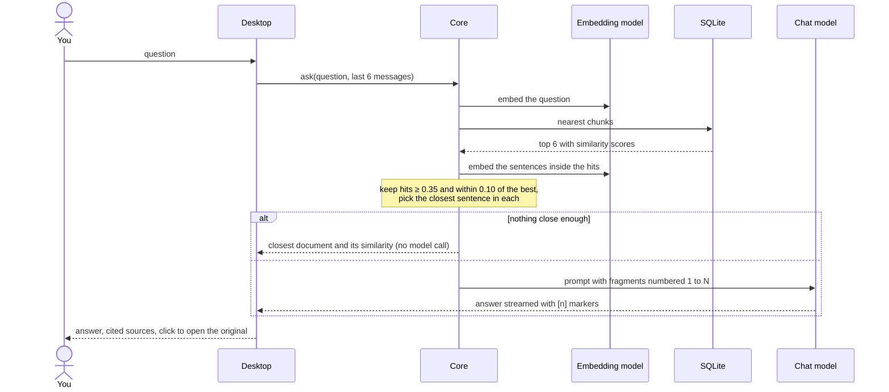
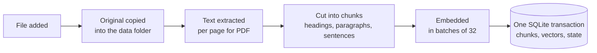
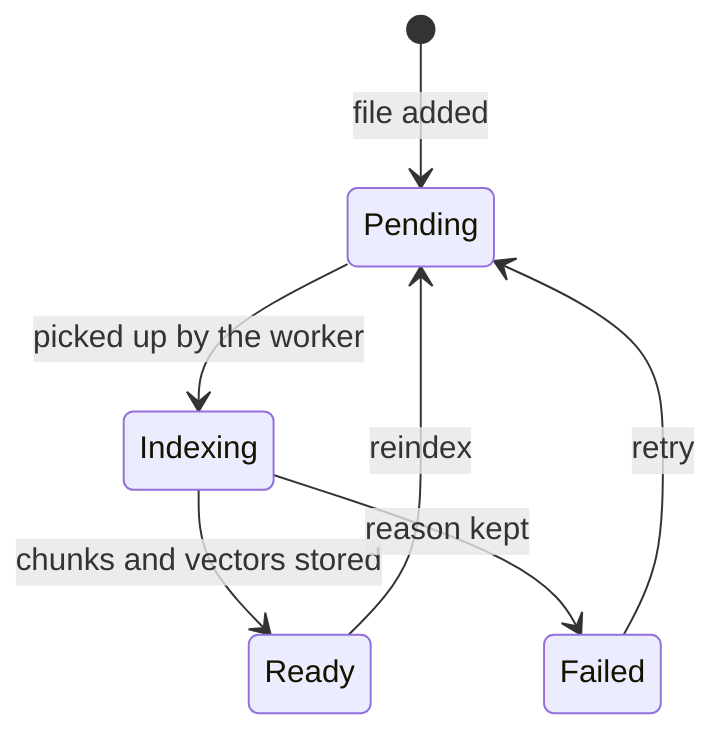
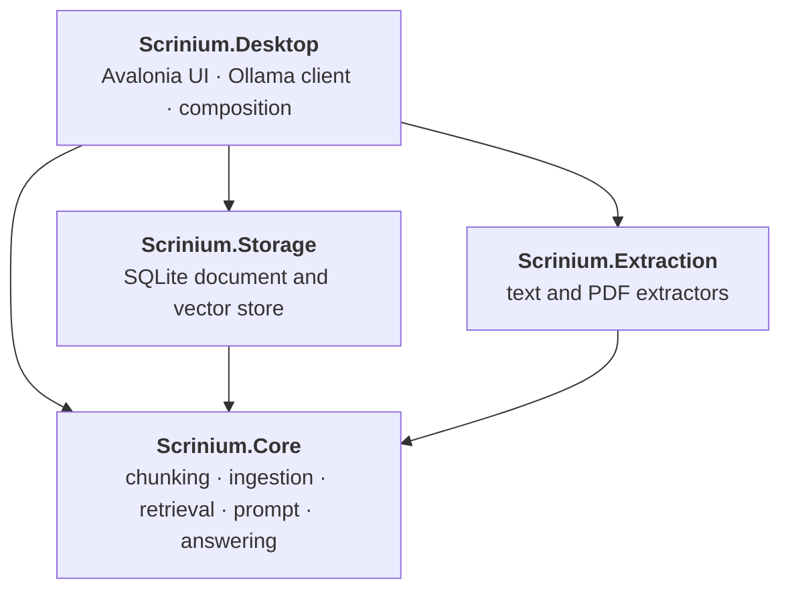

# Scrinium

[](https://github.com/sburdenko/scrinium/actions/workflows/ci.yml)
[](LICENSE)


**Ask your own documents questions in plain language and get answers you can verify.**

Scrinium is a desktop app that indexes your text, Markdown and PDF files and answers questions about them with a local language model. Every claim in an answer carries a numbered citation; a click opens the original, scrolled to the exact sentence the answer came from.

Everything runs on your machine through [Ollama](https://ollama.com). Your documents, the index and the models stay local. The only network connection the app makes is the one to your own Ollama server.

## Highlights

- **Answers with proof.** Citations are `[n]` buttons inside the answer. They open the original at the cited sentence, highlighted, on the right PDF page.
- **Honest when it does not know.** If the documents do not contain an answer, the model is told to say so, and clearly unrelated questions never reach it at all: the app names the closest document and how close it was.
- **Works across languages.** With a multilingual embedding model, a question in Russian finds a German or English document, and the answer comes back in the language of the question.
- **Local and provider-agnostic.** The core talks to models only through `IChatClient` and `IEmbeddingGenerator` from Microsoft.Extensions.AI, so the model server is a composition detail.
- **Visible state.** Each document shows whether it is queued, indexing, ready or failed (with the reason and a retry). A banner says when Ollama is not running or a model is missing, and can start Ollama and download the models.
- **Documents are data, not instructions.** Text from a file reaches the model inside markers with a standing order not to obey it.
- **Small, enforced architecture.** Four projects, one outside library each, and tests that fail when a dependency points the wrong way.

## Quick start

You need the [.NET 10 SDK](https://dotnet.microsoft.com/download) and [Ollama](https://ollama.com).

```bash
ollama pull bge-m3            # multilingual embeddings
ollama pull qwen3-coder:30b   # answers; any instruct model works
dotnet run --project src/Scrinium.Desktop
```

Then press **+ Add** or drop `.txt`, `.md` and `.pdf` files on the window, wait for the green dot next to each file, and ask.

If Ollama is not running or a model is missing, the banner at the top offers **Start Ollama** and **Download models**.

## Using it

| You want to | Do this |
|---|---|
| Add documents | **+ Add** or drag and drop files onto the window |
| Ask something | Type in the box at the bottom, **Enter** sends, **Shift+Enter** adds a line |
| Check a claim | Click the `[n]` in the answer or a card under **Sources** |
| Read the original | The right panel opens at the cited sentence; **Open file** launches the file itself |
| Find a document | Type in **Filter by name** above the list |
| Retry a failed file | The retry arrow on the file, or **Retry all failures** |
| Change models | **Settings**: pick the answer and embedding model from the models installed in Ollama |
| Start over | **New chat** |

The window follows the system light or dark theme.

## How an answer is made



Similarity scores only throw out clearly unrelated questions. Scores of relevant and irrelevant questions overlap on a corpus about one person (both land between roughly 0.4 and 0.55 with `bge-m3`), so whether the fragments really answer the question is decided by the chat model, which is told to cite only fragments that support its answer and to say so when none do.

### Three outcomes, not a flag

A search returns exactly one of three results, and the window explains each one differently:


### What happens to a file



A document is always in exactly one state:



Pending and interrupted documents are queued again at startup. Deleting a document removes its original, chunks and vectors in one transaction.

## Architecture



| Project | Job | Outside library |
|---|---|---|
| `Scrinium.Core` | Records and interfaces, chunking, the ingestion queue, retrieval, passage location, prompt building, answering. Depends on nothing else in the solution | Microsoft.Extensions.AI (interfaces only) |
| `Scrinium.Storage` | Implements the document and vector stores on one SQLite file | Microsoft.Data.Sqlite |
| `Scrinium.Extraction` | Reads text from `.txt`, `.md` and `.pdf` | PdfPig |
| `Scrinium.Desktop` | Sources, chat, original preview, settings, Ollama status. The only project that knows about Ollama and the UI toolkit | Avalonia, OllamaSharp |
| `tests/Scrinium.Tests` | Unit, architecture and composition tests with fake models | xunit |

### Rules the code follows

These are checked by `ArchitectureTests` on every build, not left to review:

- Core references no other project in the solution; Storage and Extraction reference only Core.
- SQLite, PdfPig, Avalonia and OllamaSharp each appear in exactly one project, so replacing one touches one project.
- Core models outcomes as states (`IndexState`, `RetrievalOutcome`, `ModelCatalog`, `AnswerEvent`) and has no boolean flags.
- Core values are immutable.

`CompositionTests` build the real service registration with fake models to prove that the pieces add up to a working app. For a plain-language tour and a glossary, see [docs/architecture.md](docs/architecture.md).

## Details

| Step | Behaviour |
|---|---|
| Extraction | `.txt` and `.md` read as UTF-8. PDFs are read page by page with PdfPig; a PDF without a text layer fails with a clear message |
| Chunking | Recursive: headings, blank lines, sentences, words. About 400 tokens per chunk with 50 tokens of overlap. Every chunk keeps its page and character offset |
| Embeddings | Batches of 32 through `IEmbeddingGenerator`. The model name is stored per document, and search only uses documents indexed with the current model |
| Storage | One SQLite file. Vectors are normalized `float32` blobs compared by cosine similarity |
| Retrieval | Top 6 chunks, similarity at least 0.35 and within 0.10 of the best. Neighbouring chunks are added to the context up to about 3000 tokens |
| Citations | The sentence closest to the question inside each hit. A line wrap inside a PDF sentence does not split it; list items and lines ending in punctuation do |
| Answering | Last 6 messages plus the numbered fragments go to `IChatClient`; the reply is streamed |
| Models | Default `bge-m3` for embeddings and `qwen3-coder:30b` for answers; both are chosen in Settings |

### Data

| What | Where (macOS) |
|---|---|
| Database | `~/Library/Application Support/Scrinium/data/scrinium.db` |
| Original files | `~/Library/Application Support/Scrinium/data/originals/<year>/<month>/` |
| Settings | `~/Library/Application Support/Scrinium/settings.json` |

Set the `SCRINIUM_DATA` environment variable to use another data folder. Copying the `data` folder is a complete backup.

## Development

```bash
dotnet build
dotnet test
```

The SDK version is pinned in `global.json` and warnings are errors. The tests need no Ollama: models are replaced by small fakes, and continuous integration builds and tests on macOS, Windows and Linux.

```
src/
  Scrinium.Core/         records, chunking, ingestion, retrieval, prompt, answering
  Scrinium.Storage/      SQLite stores
  Scrinium.Extraction/   text and PDF extractors
  Scrinium.Desktop/      Avalonia app
tests/
  Scrinium.Tests/        unit, architecture and composition tests
docs/
  architecture.md        the same architecture for non-programmers
```

## License

MIT, see [LICENSE](LICENSE). Third-party components are listed in [THIRD-PARTY-NOTICES.md](THIRD-PARTY-NOTICES.md).
