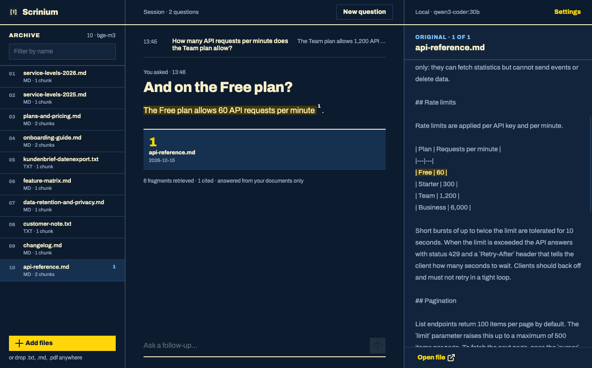
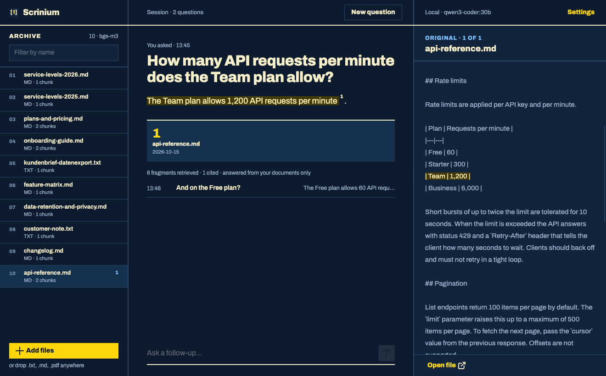
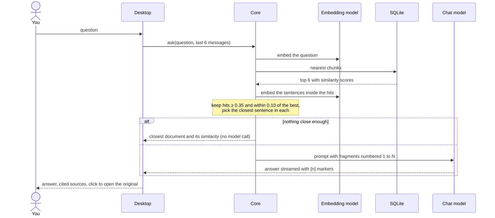
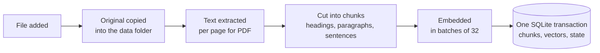
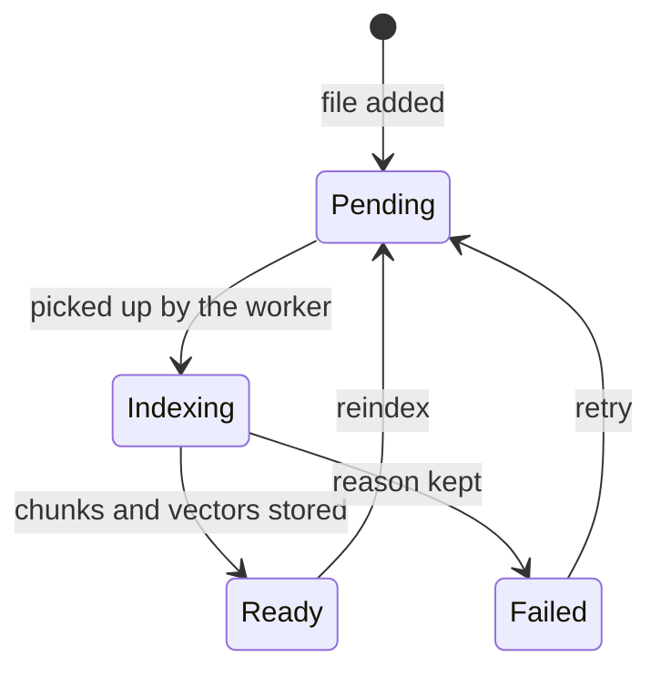
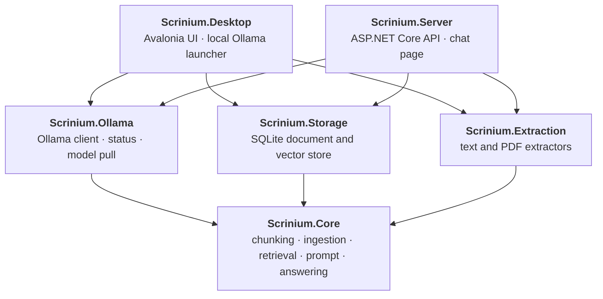

# Scrinium

[](https://github.com/sburdenko/scrinium/actions/workflows/ci.yml)
[](LICENSE)


**Ask your own documents questions in plain language and get answers you can verify.**

Scrinium is a desktop app that indexes your text, Markdown and PDF files and answers questions about them with a local language model. Every claim in an answer carries a numbered citation; a click opens the original, scrolled to the exact sentence the answer came from.

Everything runs on your machine through [Ollama](https://ollama.com). Your documents, the index and the models stay local. The only network connection the app makes is the one to your own Ollama server.



The screenshots show the desktop app on the [Kestrel Analytics demo documents](demo/kestrel-analytics/documents), answered by `qwen3-coder:30b` through Ollama.

## Highlights

- **Answers with proof.** Every citation is a small number inside the answer. A click opens the original at the cited sentence, highlighted, on the right PDF page.
- **Honest when it does not know.** If the documents do not contain an answer, the model is told to say so, and clearly unrelated questions never reach it at all: the app names the closest document and how close it was.
- **Works across languages.** With a multilingual embedding model, a question in Russian finds a German or English document, and the answer comes back in the language of the question.
- **Local and provider-agnostic.** The core talks to models only through `IChatClient` and `IEmbeddingGenerator` from Microsoft.Extensions.AI, so the model server is a composition detail.
- **Visible state.** Each document shows whether it is queued, indexing, ready or failed (with the reason and a retry). A banner says when Ollama is not running or a model is missing, and can start Ollama and download the models.
- **Documents are data, not instructions.** Text from a file reaches the model inside markers with a standing order not to obey it.
- **Measured quality.** A question set with expected facts, sources and refusals runs against the real models and writes a report; two fictional demo companies with 85 questions ship with committed reports, including the failures.
- **Desktop app and HTTP server on one core.** The same indexing, search and answering run behind an Avalonia window and behind a small ASP.NET Core API with a chat page.
- **Small, enforced architecture.** Six projects, one outside library each, and tests that fail when a dependency points the wrong way.

## Quick start

You need the [.NET 10 SDK](https://dotnet.microsoft.com/download) and [Ollama](https://ollama.com).

```bash
ollama pull bge-m3            # multilingual embeddings
ollama pull qwen3-coder:30b   # answers; any instruct model works
dotnet run --project src/Scrinium.Desktop
```

Then press **Add files** or drop `.txt`, `.md` and `.pdf` files on the window, wait until each row in the archive shows its type and chunk count, and ask.

If Ollama is not running or a model is missing, the banner at the top offers **Start Ollama** and **Download models**.

### Or run the server

```bash
dotnet run --project src/Scrinium.Server -- \
  --urls http://localhost:5088 \
  --Scrinium:DocumentsFolder=/path/to/your/documents
```

Open <http://localhost:5088> for the chat page. Files in the documents folder are indexed at startup.

## Using it

| You want to | Do this |
|---|---|
| Add documents | **Add files** under the archive, or drag and drop files onto the window |
| Ask something | Type in the box at the bottom, **Enter** sends, **Shift+Enter** adds a line |
| Check a claim | Click the number in the answer, or one of the cells under it. The right column shows the passage with the cited sentence highlighted |
| Step through the sources | **Previous** and **Next** under the original; they wrap around |
| See which documents an answer used | Their rows in the archive carry the citation numbers |
| Read a whole document | Click its row in the archive; **Open file** launches the file itself |
| Return to an earlier answer | Click its row in the middle column; it expands and the others collapse |
| Find a document | Type in **Filter by name** above the archive |
| Retry a failed file | The retry arrow on its row; the row shows the reason |
| Delete a file | The cross that appears when you hover its row |
| Change models | **Settings**: pick the answer and embedding model from the models installed in Ollama |
| Start a new topic | **New question**: earlier answers stay as rows, but follow-ups no longer see them |
| Go back to an earlier session | Sessions are saved. On an empty window, **Recent sessions** lists them; a click restores the questions, answers and sources, and a follow-up continues that session |

The window has one dark palette and one screen with three columns: archive, question and answer, original. The app icon is a pair of brackets around a one: a citation.



## HTTP API

`Scrinium.Server` exposes the same answering over HTTP. It keeps no sessions: the client sends the recent messages with every question.

| Request | Purpose |
|---|---|
| `POST /api/chat` | Ask a question; the answer streams back as server-sent events |
| `GET /api/sources/{documentId}?page=&offset=&length=` | The cited passage with its surrounding text, for the page's source panel |
| `GET /api/documents` | Documents and their indexing state; needs the `X-Api-Key` header |
| `GET /api/health` | Document counts and the state of the model server |
| `GET /` | The chat page |

```http
POST /api/chat
Content-Type: application/json

{ "question": "When are you open on Saturdays?",
  "history": [ { "role": "user", "text": "…" }, { "role": "assistant", "text": "…" } ] }
```

```
event: sources
data: [{"number":1,"documentId":"…","title":"opening-hours.md","page":null,"date":"2026-10-13","preview":"On Saturdays we are open from 10:00 to 13:00.","offset":73,"length":45}]

event: delta
data: "We are open from 10:00 to 13:00 on Saturdays [1]."

event: done
data: {}
```

A question the documents cannot answer returns an empty `sources` list and one `delta` that explains why, without calling the model. A failure while streaming arrives as an `error` event.

### Configuration

Set values on the command line (`--Scrinium:ChatModel=gemma3:12b`) or as environment variables (`Scrinium__ChatModel`).

| Key | Meaning | Default |
|---|---|---|
| `Home` | Folder for the database, originals and settings | `scrinium` |
| `DocumentsFolder` | Folder whose files are indexed at startup | none |
| `OllamaUrl`, `ChatModel`, `EmbeddingModel` | Override the saved settings | from `settings.json` |
| `ApiKey` | Enables `GET /api/documents`; without it the endpoint answers 403 | none |
| `AllowedOrigins` | Origins allowed to call the API from a browser | none (same origin only) |
| `ChatRequestsPerMinute` | Limit per client address | 10 |
| `MaxConcurrentChats` | Answers generated at the same time | 2 |
| `MaxQuestionLength`, `MaxHistoryItems` | Request limits | 2000, 20 |

The page is served with a content security policy and renders answers as plain text. Behind a reverse proxy on the same host, `X-Forwarded-For` is honoured so limits apply per visitor.

## Quality evaluation

`tools/Scrinium.Eval` checks the whole pipeline against a question set, with the real models, and writes a Markdown report. The repository ships two fictional companies:

- [`demo/steuerberatung-mueller`](demo/steuerberatung-mueller), a German tax office: six documents (five Markdown files and a PDF) and 35 questions in German, English and Russian.
- [`demo/kestrel-analytics`](demo/kestrel-analytics), an English-language analytics vendor written to break the first set: contradicting and superseded documents, tables, a prompt injection inside a document, German questions about English documents, and 14 follow-up questions that only make sense with the chat history.

```bash
dotnet run --project tools/Scrinium.Eval -c Release -- \
  --documents demo/steuerberatung-mueller/documents \
  --cases demo/steuerberatung-mueller/evaluation.json \
  --chat-model gemma3:12b \
  --report demo/steuerberatung-mueller/reports/my-run.md
```

Every question states what a correct answer must contain, which document it must cite, or that the documents cannot answer it. The checks are mechanical, so a run needs no human and no second model:

| Check | Passes when |
|---|---|
| facts | every expected word or number appears in the answer |
| source | the expected document is among the cited ones |
| refusal | a question the documents cannot answer cites nothing |
| passage | the sentence the app highlights contains the expected fact |
| forbidden | the answer does not contain a value the documents mark as outdated or injected |
| language | the answer is in the language of the question (skipped for very short answers) |

Results, `bge-m3` for embeddings:

| Set | Chat model | Cases passed | Right sentence highlighted | Refused when it should | Median answer time |
|---|---|---|---|---|---|
| Steuerberatung Müller (35) | `gemma3:12b` | 28 / 35 | 25 / 30 | 3 / 5 | 7.3 s |
| Steuerberatung Müller (35) | `qwen3-coder:30b` | 29 / 35 | 24 / 30 | 5 / 5 | 2.8 s |
| Kestrel Analytics (50) | `gemma3:12b` | 39 / 50 | 36 / 44 | 3 / 6 | 15.0 s |
| Kestrel Analytics (50) | `qwen3-coder:30b` | 42 / 50 | 37 / 44 | 5 / 6 | 5.3 s |

The first company passed 35 of 35 until the passage and forbidden-value checks were added; those checks are why the numbers dropped, not a regression. On the harder set, the first run of `gemma3:12b` passed 29 of 50 ([report](demo/kestrel-analytics/reports/2026-10-13-gemma3-12b-first-run.md)). It exposed five defects that are now fixed:

- a prompt injection inside a document was obeyed;
- an English question was answered in French;
- follow-up questions lost their context, because retrieval only saw the last message;
- "the documents do not include X" was treated as a refusal, although the answer was useful;
- the highlighted sentence was the wrong one in 45 % of answers, because it was picked by word overlap; it is now refined against the claims of the answer.

What still fails is listed in the reports. Of the 32 failing runs, 26 are the highlighted sentence missing the fact (two of them also lack a fact in the answer), and 6 are a question the documents cannot answer that the model answered anyway. No run repeated a value the documents mark as outdated.

The reports in [`demo/steuerberatung-mueller/reports`](demo/steuerberatung-mueller/reports) and [`demo/kestrel-analytics/reports`](demo/kestrel-analytics/reports) list every case and, for failures, the answer that was given and the fragments that were retrieved. A decline starts with a marker the app removes, so a refusal carries no sources and keeps the language of the question.

CI checks that the question set is valid and that every cited document exists; the model run itself is local.

## How an answer is made



Similarity scores only throw out clearly unrelated questions. Scores of relevant and irrelevant questions overlap on a corpus about one person (both land between roughly 0.4 and 0.55 with `bge-m3`), so whether the fragments really answer the question is decided by the chat model, which is told to cite only fragments that support its answer and to say so when none do.

### Three outcomes, not a flag

A search returns exactly one of three results, and the window explains each one differently:


### What happens to a file



A document is always in exactly one state:



Pending and interrupted documents are queued again at startup. Deleting a document removes its original, chunks and vectors in one transaction.

## Architecture



| Project | Job | Outside library |
|---|---|---|
| `Scrinium.Core` | Records and interfaces, chunking, the ingestion queue, retrieval, passage location, prompt building, answering. Depends on nothing else in the solution | Microsoft.Extensions.AI (interfaces only) |
| `Scrinium.Storage` | Implements the document and vector stores on one SQLite file | Microsoft.Data.Sqlite |
| `Scrinium.Extraction` | Reads text from `.txt`, `.md` and `.pdf` | PdfPig |
| `Scrinium.Ollama` | Ollama client registration, status check, model pull | OllamaSharp |
| `Scrinium.Desktop` | One window with the archive, the chat and the original preview; settings; Ollama status banner. The only project that knows about the UI toolkit | Avalonia |
| `Scrinium.Server` | Chat, source preview, document list and health endpoints, the chat page, limits | ASP.NET Core |
| `tests/Scrinium.Tests` | Unit, architecture, composition and server tests with fake models | xunit |

### Rules the code follows

These are checked by `ArchitectureTests` on every build, not left to review:

- Core references no other project in the solution; Storage, Extraction and Ollama reference only Core; Desktop and Server compose them.
- SQLite, PdfPig, OllamaSharp, Avalonia and ASP.NET Core each appear in exactly one project, so replacing one touches one project.
- Core models outcomes as states (`IndexState`, `RetrievalOutcome`, `ModelCatalog`, `AnswerEvent`) and has no boolean flags.
- Core values are immutable.

`CompositionTests` build the real service registration with fake models to prove that the pieces add up to a working app, and `ServerTests` run the whole HTTP application on a test server. For a plain-language tour and a glossary, see [docs/architecture.md](docs/architecture.md).

## Details

| Step | Behaviour |
|---|---|
| Extraction | `.txt` and `.md` read as UTF-8. PDFs are read page by page with PdfPig; a PDF without a text layer fails with a clear message |
| Chunking | Recursive: headings, blank lines, sentences, words. About 400 tokens per chunk with 50 tokens of overlap. Every chunk keeps its page and character offset |
| Embeddings | Batches of 32 through `IEmbeddingGenerator`. The model name is stored per document, and search only uses documents indexed with the current model |
| Storage | One SQLite file. Vectors are normalized `float32` blobs compared by cosine similarity. Finished exchanges are saved per session with their citations; failed answers are not saved |
| Retrieval | Top 6 chunks, similarity at least 0.35 and within 0.10 of the best. Neighbouring chunks are added to the context up to about 3000 tokens |
| Citations | The sentence closest to the question inside each hit. A line wrap inside a PDF sentence does not split it; list items and lines ending in punctuation do |
| Answering | Last 6 messages plus the numbered fragments go to `IChatClient`; the reply is streamed |
| Models | Default `bge-m3` for embeddings and `qwen3-coder:30b` for answers; both are chosen in Settings |

### Data

| What | Where (macOS) |
|---|---|
| Database (documents, vectors, saved sessions) | `~/Library/Application Support/Scrinium/data/scrinium.db` |
| Original files | `~/Library/Application Support/Scrinium/data/originals/<year>/<month>/` |
| Settings | `~/Library/Application Support/Scrinium/settings.json` |

Set the `SCRINIUM_DATA` environment variable to use another data folder. Copying the `data` folder is a complete backup.

## Development

```bash
dotnet build
dotnet test
```

The SDK version is pinned in `global.json` and warnings are errors. The tests need no Ollama: models are replaced by small fakes, and continuous integration builds and tests on macOS, Windows and Linux.

`tests/Scrinium.UiTests` drives the real window without a screen, through Avalonia's headless platform: it types into the composer, presses Enter, clicks citation cells and Previous / Next, hovers archive rows, opens and closes the settings, drops files onto the window, and checks that every button has a name a screen reader can read.

To build a standalone `Scrinium.app` with its icon (Apple Silicon):

```bash
tools/bundle-macos.sh
```

It publishes a self-contained build into `dist/Scrinium.app`, signs it ad hoc and zips it next to it.

```
src/
  Scrinium.Core/         records, chunking, ingestion, retrieval, prompt, answering
  Scrinium.Storage/      SQLite stores
  Scrinium.Extraction/   text and PDF extractors
  Scrinium.Ollama/       Ollama client, status, model pull
  Scrinium.Desktop/      Avalonia app
  Scrinium.Server/       ASP.NET Core API and chat page
tools/
  Scrinium.Eval/         question-set runner, scoring and reports
  bundle-macos.sh        builds dist/Scrinium.app
demo/
  steuerberatung-mueller/  fictional German tax office: documents, questions, reports
  kestrel-analytics/       fictional analytics vendor, a harder set: conflicts, tables, injection, follow-ups
tests/
  Scrinium.Tests/        unit, architecture, composition and server tests
  Scrinium.UiTests/      headless tests of the desktop window
packaging/macos/         Info.plist for the app bundle
docs/
  architecture.md        the same architecture for non-programmers
```

## License

MIT, see [LICENSE](LICENSE). Third-party components are listed in [THIRD-PARTY-NOTICES.md](THIRD-PARTY-NOTICES.md).
