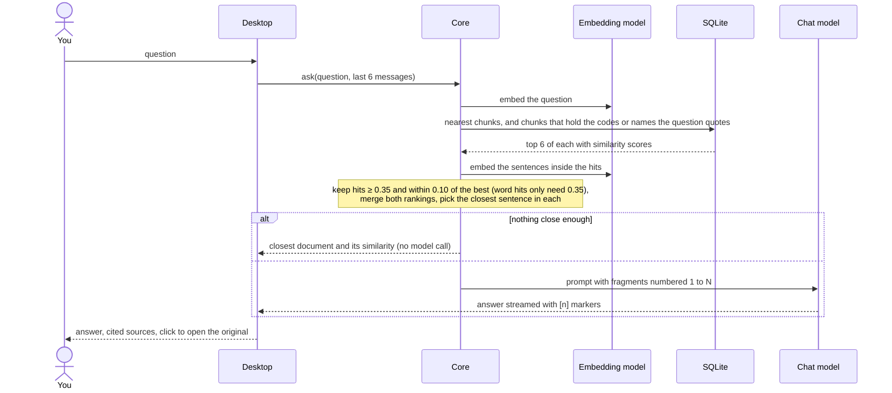
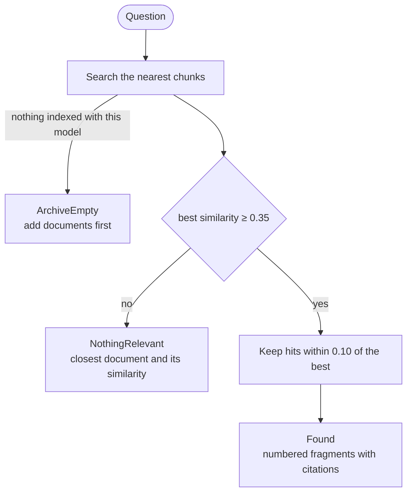
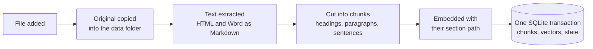
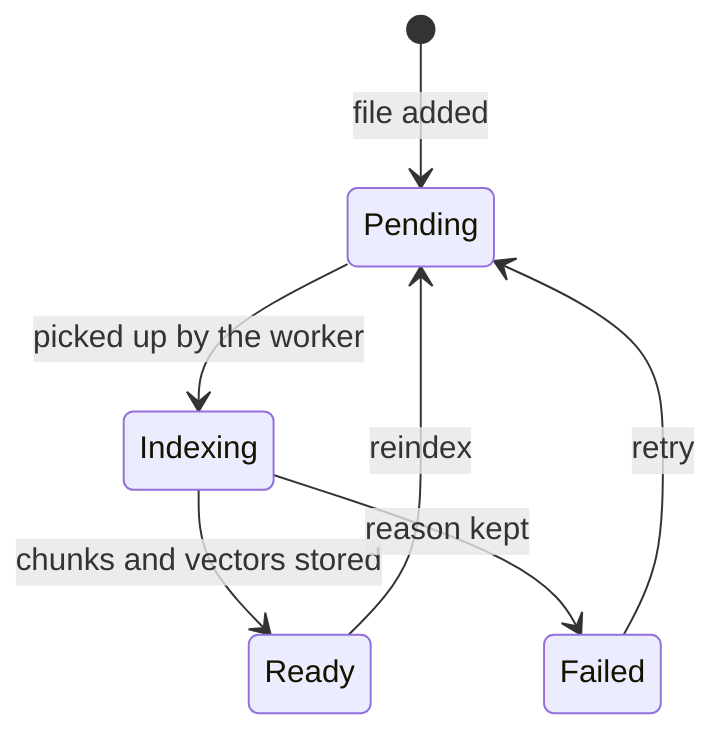
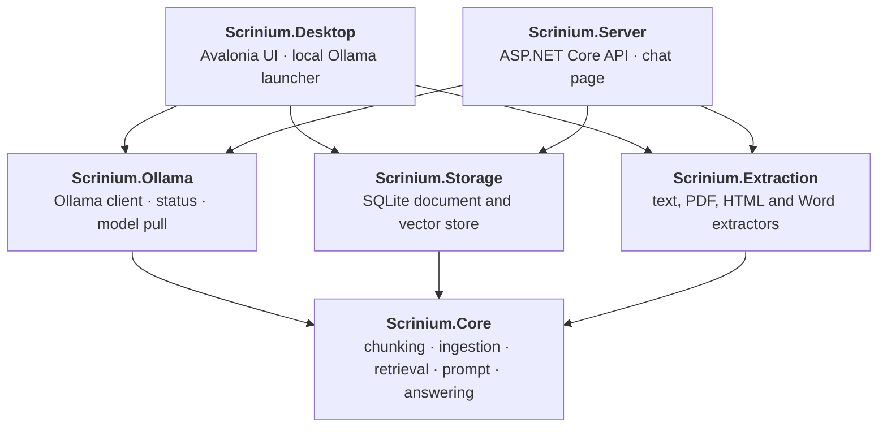

# Scrinium

[](https://github.com/sburdenko/scrinium/actions/workflows/ci.yml)
[](LICENSE)


**Ask your own documents questions in plain language and get answers you can verify.**

Scrinium is a desktop app that indexes your text, Markdown, PDF, HTML and Word files and answers questions about them with a local language model. Every claim in an answer carries a numbered citation; a click opens the original, scrolled to the exact sentence the answer came from.

Everything runs on your machine through [Ollama](https://ollama.com). Your documents, the index and the models stay local. The only network connection the app makes is the one to your own Ollama server.


The screenshots show the desktop app on the [Kestrel Analytics demo documents](demo/kestrel-analytics/documents), answered by `qwen3-coder:30b` through Ollama.

## Highlights

- **Answers with proof.** Every citation is a small number inside the answer. A click opens the original at the cited sentence, highlighted, on the right PDF page.
- **Honest when it does not know.** If the documents do not contain an answer, the model is told to say so, and clearly unrelated questions never reach it at all: the app names the closest document and how close it was.
- **Works across languages.** With a multilingual embedding model, a question in Russian finds a German or English document, and the answer comes back in the language of the question.
- **Local and provider-agnostic.** The core talks to models only through `IChatClient` and `IEmbeddingGenerator` from Microsoft.Extensions.AI, so the model server is a composition detail.
- **Visible state.** Each document shows whether it is queued, indexing, ready or failed (with the reason and a retry). A banner says when Ollama is not running or a model is missing, and can start Ollama and download the models.
- **Documents are data, not instructions.** Text from a file reaches the model inside markers with a standing order not to obey it.
- **Measured quality.** A question set with expected facts, sources and refusals runs against the real models and writes a report; four fictional demo companies with 160 questions ship with committed reports, including the failures, and one of them is a held-out set nothing is tuned on.
- **Workspaces that cannot see each other.** Each workspace is a folder with its own database, originals and saved sessions, so "Work" never answers from "Personal", and one server can serve several companies.
- **Desktop app and HTTP server on one core.** The same indexing, search and answering run behind an Avalonia window and behind a small ASP.NET Core API with a chat page.
- **Small, enforced architecture.** Six projects, every outside library in exactly one of them, and tests that fail when a dependency points the wrong way.

## Quick start

You need the [.NET 10 SDK](https://dotnet.microsoft.com/download) and [Ollama](https://ollama.com).

```bash
ollama pull bge-m3            # multilingual embeddings
ollama pull qwen3-coder:30b   # answers; any instruct model works
dotnet run --project src/Scrinium.Desktop
```

Then press **Add files** or drop `.txt`, `.md`, `.pdf`, `.html` and `.docx` files on the window, wait until each row in the archive shows its type and chunk count, and ask.

If Ollama is not running or a model is missing, the banner at the top offers **Start Ollama** and **Download models**.

### Or run the server

```bash
dotnet run --project src/Scrinium.Server -- \
  --urls http://localhost:5088 \
  --Scrinium:DocumentsFolder=/path/to/your/documents
```

Open <http://localhost:5088> for the chat page. Files in the documents folder are indexed at startup.

## Using it

| You want to | Do this |
|---|---|
| Add documents | **Add files** under the archive, or drag and drop files onto the window |
| Ask something | Type in the box at the bottom, **Enter** sends, **Shift+Enter** adds a line |
| Check a claim | Click the number in the answer, or one of the cells under it. The right column shows the passage with the cited sentence highlighted |
| Step through the sources | **Previous** and **Next** under the original; they wrap around |
| See which documents an answer used | Their rows in the archive carry the citation numbers |
| Read a whole document | Click its row in the archive; **Open file** launches the file itself |
| Return to an earlier answer | Click its row in the middle column; it expands and the others collapse |
| Find a document | Type in **Filter by name** above the archive |
| Retry a failed file | The retry arrow on its row; the row shows the reason |
| Delete a file | The cross that appears when you hover its row |
| Change models | **Settings**: pick the answer and embedding model from the models installed in Ollama |
| Keep subjects apart | Pick a workspace above the archive, or create one with **+**. Each workspace has its own documents and sessions; the window reopens the last one |
| Start a new topic | **New question**: earlier answers stay as rows, but follow-ups no longer see them |
| Go back to an earlier session | Sessions are saved. On an empty window, **Recent sessions** lists them; a click restores the questions, answers and sources, and a follow-up continues that session |

The window has one dark palette and one screen with three columns: archive, question and answer, original. The app icon is a pair of brackets around a one: a citation.


## HTTP API

`Scrinium.Server` exposes the same answering over HTTP. It keeps no sessions: the client sends the recent messages with every question.

| Request | Purpose |
|---|---|
| `POST /api/chat` | Ask a question; the answer streams back as server-sent events |
| `GET /api/sources/{documentId}?page=&offset=&length=` | The cited passage with its surrounding text, for the page's source panel |
| `GET /api/documents` | Documents and their indexing state; needs the `X-Api-Key` header |
| `GET /api/health` | Document counts and the state of the model server |
| `GET /` | The chat page |

Every request also exists under `/w/{workspace}/`, for example `POST /w/kestrel/api/chat` and the chat page at `/w/kestrel/`. Requests without the prefix use the default workspace. A workspace answers only from its own documents, reads only its own sources, and checks its own API key; an unknown workspace answers 404.

```http
POST /api/chat
Content-Type: application/json

{ "question": "When are you open on Saturdays?",
  "history": [ { "role": "user", "text": "…" }, { "role": "assistant", "text": "…" } ] }
```

```
event: sources
data: [{"number":1,"documentId":"…","title":"opening-hours.md","page":null,"date":"2026-10-13","preview":"On Saturdays we are open from 10:00 to 13:00.","offset":73,"length":45}]

event: delta
data: "We are open from 10:00 to 13:00 on Saturdays [1]."

event: done
data: {}
```

A question the documents cannot answer returns an empty `sources` list and one `delta` that explains why, without calling the model. A failure while streaming arrives as an `error` event.

### Configuration

Set values on the command line (`--Scrinium:ChatModel=gemma3:12b`) or as environment variables (`Scrinium__ChatModel`).

```bash
dotnet run --project src/Scrinium.Server -- --urls http://localhost:5088 \
  --Scrinium:DocumentsFolder=demo/steuerberatung-mueller/documents \
  --Scrinium:Workspaces:0:Id=kestrel \
  --Scrinium:Workspaces:0:DocumentsFolder=demo/kestrel-analytics/documents
```

This serves the tax office at <http://localhost:5088> and the analytics vendor at <http://localhost:5088/w/kestrel/>, each from its own database.

| Key | Meaning | Default |
|---|---|---|
| `Home` | Folder for the workspaces (databases, originals) and settings | `scrinium` |
| `DocumentsFolder` | Folder whose files are indexed at startup | none |
| `OllamaUrl`, `ChatModel`, `EmbeddingModel` | Override the saved settings | from `settings.json` |
| `ApiKey` | Enables `GET /api/documents` of the default workspace; without it the endpoint answers 403 | none |
| `Workspaces:{n}:Id` | Another workspace, served under `/w/{Id}/`: lowercase letters, digits and dashes | none |
| `Workspaces:{n}:Name`, `DocumentsFolder`, `ApiKey` | Its display name, the folder indexed at startup and the key for its document list | id, none, none |
| `AllowedOrigins` | Origins allowed to call the API from a browser | none (same origin only) |
| `ChatRequestsPerMinute` | Limit per client address | 10 |
| `MaxConcurrentChats` | Answers generated at the same time | 2 |
| `MaxQuestionLength`, `MaxHistoryItems` | Request limits | 2000, 20 |

The page is served with a content security policy and renders answers as plain text. Behind a reverse proxy on the same host, `X-Forwarded-For` is honoured so limits apply per visitor.

## Quality evaluation

`tools/Scrinium.Eval` checks the whole pipeline against a question set, with the real models, and writes a Markdown report. The repository ships four fictional companies:

- [`demo/steuerberatung-mueller`](demo/steuerberatung-mueller), a German tax office: six documents (five Markdown files and a PDF) and 35 questions in German, English and Russian.
- [`demo/kestrel-analytics`](demo/kestrel-analytics), an English-language analytics vendor written to break the first set: contradicting and superseded documents, tables, a prompt injection inside a document, German questions about English documents, and 14 follow-up questions that only make sense with the chat history.
- [`demo/velo-nord`](demo/velo-nord), a bicycle workshop in English and German with 32 questions. It is the **held-out set**: it was written after the rules below were tuned on the first two sets, and nothing is tuned on it. Its numbers are the honest estimate of how the app does on documents it was not shaped for.
- [`demo/brightmoor-labs`](demo/brightmoor-labs), a software vendor with 43 questions about formats other than Markdown: HTML pages with navigation, scripts and a footer that hold wrong values, Word documents with heading styles, lists, a table, a tracked change and code set in Consolas, fenced code examples, and long sections whose facts sit far from the heading that names them. The Word files are written by [`build-documents.cs`](demo/brightmoor-labs/build-documents.cs).

```bash
dotnet run --project tools/Scrinium.Eval -c Release -- \
  --documents demo/steuerberatung-mueller/documents \
  --cases demo/steuerberatung-mueller/evaluation.json \
  --chat-model gemma3:12b \
  --report demo/steuerberatung-mueller/reports/my-run.md
```

Every question states what a correct answer must contain, which document it must cite, or that the documents cannot answer it. The checks are mechanical, so a run needs no human and no second model:

| Check | Passes when |
|---|---|
| facts | every expected word or number appears in the answer |
| source | the expected document is among the cited ones |
| refusal | a question the documents cannot answer cites nothing |
| passage | the sentence the app highlights contains the expected fact |
| forbidden | the answer does not contain a value the documents mark as outdated or injected |
| language | the answer is in the language of the question (skipped for very short answers) |

Results with `bge-m3` for embeddings, run on 19 October with nothing else using Ollama. The runs of 13 and 16 October are in the same `reports` folders.

| Set | Chat model | Cases passed | Right sentence highlighted | Refused when it should | Median answer time |
|---|---|---|---|---|---|
| Steuerberatung Müller (35) | `gemma3:12b` | 35 / 35 | 30 / 30 | 5 / 5 | 8.1 s |
| Steuerberatung Müller (35) | `qwen3-coder:30b` | 35 / 35 | 30 / 30 | 5 / 5 | 2.4 s |
| Kestrel Analytics (50) | `gemma3:12b` | 48 / 50 | 42 / 44 | 6 / 6 | 17.8 s |
| Kestrel Analytics (50) | `qwen3-coder:30b` | 49 / 50 | 43 / 44 | 6 / 6 | 5.3 s |
| Velo Nord, held out (32) | `gemma3:12b` | 28 / 32 | 24 / 27 | 4 / 5 | 9.8 s |
| Velo Nord, held out (32) | `qwen3-coder:30b` | 26 / 32 | 21 / 27 | 5 / 5 | 2.5 s |
| Brightmoor Labs (43) | `gemma3:12b` | 41 / 43 | 37 / 39 | 4 / 4 | 10.9 s |
| Brightmoor Labs (43) | `qwen3-coder:30b` | 41 / 43 | 37 / 39 | 4 / 4 | 4.3 s |

Of the 17 failing runs on 19 October, 16 highlight a sentence that does not hold the expected fact; four of them also miss a fact or cite the wrong document. The remaining run answered a question the documents cannot answer. No run repeated a forbidden value or answered in the wrong language.

The first two sets were used to find and fix the defects, so their numbers are an upper bound. The held-out set is lower, and that gap is the point of having it. The same code scored 24 and 26 of 32 with `qwen3-coder:30b` in two runs, so a difference of two cases is within the model's own variation. Across the two held-out runs, three flaws in the highlight rules showed up; they are the next thing to fix, together with a new held-out set:

- a year counts for more than a price, because longer numbers weigh more: "59 euros from 1 March 2026" highlights the sentence about 1 March 2026;
- a digit in the answer's wording, as in "according to fragment 2", can move a citation to a table row that holds a 2;
- when one citation carries two claims, the first is highlighted even when the question asked about the second.

One held-out case was changed after its first run: `rent-week-city` expected only the computed "60", which no document contains, and the dataset check that every expected fact appears in a source rejected it. It now accepts "60" or "four times"; the numbers above are from the run after that change.

On 16 October the median answer time of `qwen3-coder:30b` on the Kestrel set had grown from 5.3 to 8.8 seconds; on 19 October, with nothing else using Ollama, it was 5.3 seconds again.

How the numbers moved on the first two sets:

- A decline written after an answer ("… [[NONE]]") is now a decline, and a decline that is in fact grounded in its cited fragment keeps its sources.
- The prompt tells a stated absence ("not included" answers the question) from a missing mention (which declines).
- The highlight follows the answer's claim: the full text since the previous citation marker, the figures it states, the question, and the neighbouring chunks. A citation whose fragment lacks the stated figure moves to the fragment that holds it, two sentences the answer both restates are highlighted together, and headings and colon-ended lead-ins are evidence only for a figure they state.
- German dates such as "31. Juli" no longer split a sentence, and the query rewriter can no longer invent numbers.
- Three cases name what their highlight must hold, because the answer's words cannot appear in the source: two table rows whose answer is in the column names, and a Russian question about a German document.

Earlier, the first run of `gemma3:12b` on the Kestrel set passed 29 of 50 ([report](demo/kestrel-analytics/reports/2026-10-13-gemma3-12b-first-run.md)) and exposed a prompt injection that was obeyed, an English question answered in French, follow-ups that lost their context, and "not included" treated as a refusal. No run has repeated a value the documents mark as outdated or injected.

The reports in each set's `reports` folder list every case and, for failures, the answer, the highlighted sentence and the fragments that were retrieved.

CI checks that the question set is valid and that every cited document exists; the model run itself is local.

## How an answer is made



Similarity scores only throw out clearly unrelated questions. Scores of relevant and irrelevant questions overlap on a corpus about one person (both land between roughly 0.4 and 0.55 with `bge-m3`), so whether the fragments really answer the question is decided by the chat model, which is told to cite only fragments that support its answer and to say so when none do.

### Three outcomes, not a flag

A search returns exactly one of three results, and the window explains each one differently:



### What happens to a file



A document is always in exactly one state:



Pending and interrupted documents are queued again at startup. Deleting a document removes its original, chunks and vectors in one transaction.

## Architecture



| Project | Job | Outside library |
|---|---|---|
| `Scrinium.Core` | Records and interfaces, workspaces, chunking, the ingestion queue, retrieval, passage location, prompt building, answering. Depends on nothing else in the solution | Microsoft.Extensions.AI (interfaces only) |
| `Scrinium.Storage` | Implements the document and vector stores on one SQLite file | Microsoft.Data.Sqlite |
| `Scrinium.Extraction` | Reads text from `.txt`, `.md`, `.pdf`, `.html` and `.docx` | PdfPig, HtmlAgilityPack, Open XML SDK |
| `Scrinium.Ollama` | Ollama client registration, status check, model pull | OllamaSharp |
| `Scrinium.Desktop` | One window with the archive, the chat and the original preview; settings; Ollama status banner. The only project that knows about the UI toolkit | Avalonia |
| `Scrinium.Server` | Chat, source preview, document list and health endpoints, the chat page, limits | ASP.NET Core |
| `tests/Scrinium.Tests` | Unit, architecture, composition and server tests with fake models | xunit |

### Rules the code follows

These are checked by `ArchitectureTests` on every build, not left to review:

- Core references no other project in the solution; Storage, Extraction and Ollama reference only Core; Desktop and Server compose them.
- SQLite, PdfPig, HtmlAgilityPack, the Open XML SDK, OllamaSharp, Avalonia and ASP.NET Core each appear in exactly one project, so replacing one touches one project.
- Core models outcomes as states (`IndexState`, `RetrievalOutcome`, `ModelCatalog`, `AnswerEvent`) and has no boolean flags.
- Core values are immutable.

`CompositionTests` build the real service registration with fake models to prove that the pieces add up to a working app, and `ServerTests` run the whole HTTP application on a test server. For a plain-language tour and a glossary, see [docs/architecture.md](docs/architecture.md).

## Details

| Step | Behaviour |
|---|---|
| Extraction | `.txt` and `.md` read as UTF-8. PDFs are read page by page with PdfPig; a PDF without a text layer fails with a clear message. HTML pages become Markdown without scripts, styles, navigation and footers, preferring `<main>`. Word documents become Markdown from their heading styles, numbering, tables and code styles or monospace fonts; deleted revisions are left out. Word 97-2003 `.doc` files are refused with a request to save them as `.docx` |
| Chunking | Recursive: headings, blank lines, sentences, words. About 400 tokens per chunk with 50 tokens of overlap that starts at a sentence. Fenced code blocks become chunks of their own, marked as code. Every chunk keeps its page, character offset and the path of the headings above it, which goes into its embedding and into the prompt |
| Embeddings | Batches of 32 through `IEmbeddingGenerator`. The model name is stored per document, and search only uses documents indexed with the current model |
| Storage | One SQLite file. Vectors are normalized `float32` blobs compared by cosine similarity. Finished exchanges are saved per session with their citations; failed answers are not saved |
| Retrieval | Hybrid: the top 6 chunks by meaning, plus the top 6 that contain an identifier the question names (a code such as `E507`, a flag, a path, a constant, quoted text), found with SQLite FTS5 in the same database. Every hit needs a similarity of at least 0.35; meaning hits must also be within 0.10 of the best. The two rankings are merged by reciprocal rank fusion. A question without identifiers is searched by meaning only. Neighbouring chunks are added to the context up to about 3000 tokens |
| Citations | The sentence closest to the question inside each hit. A line wrap inside a PDF sentence does not split it; list items and lines ending in punctuation do |
| Answering | Last 6 messages plus the numbered fragments go to `IChatClient`; the reply is streamed |
| Models | Default `bge-m3` for embeddings and `qwen3-coder:30b` for answers; both are chosen in Settings |

### Data

| What | Where (macOS) |
|---|---|
| One workspace (database with documents, vectors and saved sessions; originals) | `~/Library/Application Support/Scrinium/data/workspaces/<workspace>/` |
| Its database | `…/workspaces/<workspace>/scrinium.db` |
| Its original files | `…/workspaces/<workspace>/originals/<year>/<month>/` |
| Settings | `~/Library/Application Support/Scrinium/settings.json` |

Set the `SCRINIUM_DATA` environment variable to use another data folder. Copying the `data` folder is a complete backup; copying one workspace folder backs up that workspace. Data from before workspaces moves into the `default` workspace on first start.

## Development

```bash
dotnet build
dotnet test
```

The SDK version is pinned in `global.json` and warnings are errors. The tests need no Ollama: models are replaced by small fakes, and continuous integration builds and tests on macOS, Windows and Linux.

`tests/Scrinium.UiTests` drives the real window without a screen, through Avalonia's headless platform: it types into the composer, presses Enter, clicks citation cells and Previous / Next, hovers archive rows, opens and closes the settings, drops files onto the window, and checks that every button has a name a screen reader can read.

To build a standalone `Scrinium.app` with its icon (Apple Silicon):

```bash
tools/bundle-macos.sh
```

It publishes a self-contained build into `dist/Scrinium.app`, signs it ad hoc and zips it next to it.

```
src/
  Scrinium.Core/         records, chunking, ingestion, retrieval, prompt, answering
  Scrinium.Storage/      SQLite stores
  Scrinium.Extraction/   text, PDF, HTML and Word extractors
  Scrinium.Ollama/       Ollama client, status, model pull
  Scrinium.Desktop/      Avalonia app
  Scrinium.Server/       ASP.NET Core API and chat page
tools/
  Scrinium.Eval/         question-set runner, scoring and reports
  bundle-macos.sh        builds dist/Scrinium.app
demo/
  steuerberatung-mueller/  fictional German tax office: documents, questions, reports
  kestrel-analytics/       fictional analytics vendor, a harder set: conflicts, tables, injection, follow-ups
  velo-nord/               fictional bicycle workshop, the held-out set nothing is tuned on
  brightmoor-labs/         fictional software vendor: HTML, Word, code and long sections
tests/
  Scrinium.Tests/        unit, architecture, composition and server tests
  Scrinium.UiTests/      headless tests of the desktop window
packaging/macos/         Info.plist for the app bundle
docs/
  architecture.md        the same architecture for non-programmers
```

## License

MIT, see [LICENSE](LICENSE). Third-party components are listed in [THIRD-PARTY-NOTICES.md](THIRD-PARTY-NOTICES.md).
